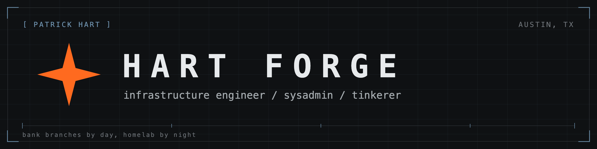

<p align="center">
  
</p>

```text
patrick@hartforge:~$ whoami
patrick hart - infrastructure engineer, sysadmin, tinkerer
```

bank branches by day, homelab by night. based in austin, tx and headed toward systems architecture and solutions engineering. everything i build gets written down at **[hartforge.com](https://hartforge.com)**.

### [ the day job ]

onsite solutions work for community banks: new institution onboardings, branch buildouts, and the breaks nobody can fix remotely. windows server, active directory, group policy, the switches and firewalls underneath, and powershell so the same problem never gets solved by hand twice.

### [ the forge ]

my homelab, run like production. proxmox and bare metal nixos boxes, self-hosted git as the primary, wireguard between sites, offsite backups, and an agent called paimon that helps run it. the writeups are on the [architecture](https://hartforge.com/architecture) page.

### [ cinder works ]

minecraft mods and modpacks i make on the side, all neoforge 1.21.1.

- **[plinthworks](https://github.com/cinderworks-mc/plinthworks)** - pedestals you teach with sigils to move items, energy, fluids and xp
- **[nullspace](https://github.com/cinderworks-mc/nullspace)** - a tempad addon that gives every player a pocket workshop room
- **[the foundry](https://modrinth.com/modpack/the-foundry-pack)** - the modpack that ties it together

### [ find me ]

```text
-> hartforge.com            the site
-> hartforge.com/now        what i'm on right now
-> hartforge.com/hire       deciding whether to email me? start here
-> resume@hartforge.com
```
